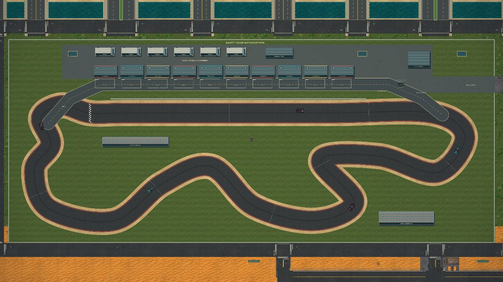
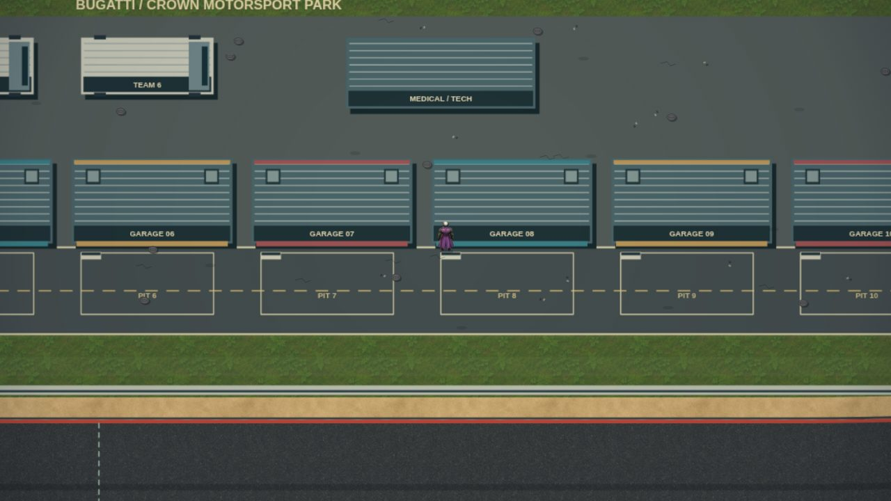

# Crown Motorsport Park, recovery and casino polish

The southwest circuit now has a 12,916-unit racing line (previously about 7,262), a 216-unit-wide road (previously 136), ten garages, transport paddock, medical and control buildings, two spectator stands and a connected perimeter boulevard. Pit entry and exit connect to the course; the eastern public entrance connects to the city. A 40 km/h limiter uses the normal braking physics. Buildings, pit wall and fences have collision footprints; the new buildings also obstruct low aircraft. Scenery and county signs were cleared or relocated where the venue replaced the old roads.

## Racing, missions and recovery

- Select **Club / 180s**, **Sport / 150s** or **Pro / 125s** in **CREW → WORKSHOP**. Targets, runoff tolerance and opponent pace vary together. Each class saves its own best; an active trial or circuit contract locks the selection. Old short-course records reset while lifetime lap counts remain.
- Five opponents use steering, braking and collision physics. All three classes complete clean full-physics laps in regression tests. The circuit contract requires eight ordered sectors, a clean qualifying time and a pit return before paying once.
- The start desk explains an occupied grid rather than accidentally entering another vehicle. Destroyed loaners are reused. Race countdown, launch, sector, finish and invalid-lap cues have distinct bounded audio effects.
- **RECOVER RIOT** returns Chaos's existing car to Hunter Garage. Visit on foot without an active job or wanted level. Recovery checks the complete body against buildings, both reserved bays, vehicles and people; it waits if both bays are blocked. Story-required replacement vehicles receive the same full-body placement checks and replace the existing wreck rather than accumulating copies.
- Expansion job timers start at pickup. Train journeys and skipped journeys use the same clock rule. Started contracts still consume time in transit.

## Casino and touch presentation

Slot reels now use reusable illustrated symbols, a visible centre payline and distinct reel-stop sounds. Blackjack has a richer felt/chip presentation and rejects invalid stakes or input from the slot screen. HOUSE EDGE displays the actual dealer ledgers and cage receipt, with a hold-progress ring and feedback for heat, movement and on-foot collection. Existing chip-only payout rules remain covered by tests.

Workshop controls use two columns on short landscape screens. Opening the modal clears the hidden minimap's input target, which previously intercepted taps over its corner. Touch recovery, class selection and button bounds are verified at 568×320, 390×844 and 1440×900.

## Traffic and performance evidence

Testing the expanded world exposed three pedestrian-related queue failures: people waiting too close to a curb, sleeping offscreen actors retaining old movement velocity, and crossing pedestrians unable to escape contact between two stopped cars. Waiting bodies now step back, sleeping velocity clears, and the local walker permits movement that clears existing contact without moving deeper into a vehicle.

In the seeded four-minute full-game soak, the initial expanded build had **40.8%** of final-minute samples moving, a **207s** maximum wait and **30.3%** of final samples waiting over 45s. After the fixes: **59.7%** moving, **44s** maximum wait and **0%** of final samples over 45s. This is one reproducible scenario, not a claim that every possible traffic blockage is solved. The separate five-minute road-only soak keeps 70.8% moving with a maximum wait of 32s.

The large venue reuses one static atlas, capped at 2048×862 in Performance (6.7 MiB) and 4096×1723 on PC (26.9 MiB). Quality changes retire the previous backing image. Collisions and racing geometry keep full precision.

The cold-render comparison uses mobile Chromium at 844×390 / DPR 2, Performance quality and 4× CPU throttling. Simulation is paused to isolate rendering. The baseline is the previously published commit, `819413b`.

| Location | Render p95 before → after | Maximum before → after | Frames to detail before → after |
| --- | --- | --- | --- |
| Circuit | 28.6 → 7.1 ms | 175.3 → 185.8 ms | 56 → 20 |
| Airfield | 12.1 → 14.1 ms | 30.8 → 38.7 ms | 40 → 45 |
| Forest | 11.1 → 10.8 ms | 297.1 → 16.3 ms | 24 → 28 |
| East gateway | 21.3 → 25.0 ms | 240.6 → 285.5 ms | 40 → 36 |

The circuit's typical cold-render work improves, but first-use stalls remain and other scenes are mixed. These are short browser samples; no physical Redmi Note was available. They do not establish a universal FPS gain. Asset decoding, lighting warm-up and dense junctions remain candidates for a focused performance pass.

[Raw measurements](performance/circuit-paddock-pass.json). Reproduce with `tools/streaming-profile.cjs` and `tools/traffic-audit.mjs`.

Validation: 275 Node regressions; 19 core Chromium checks; mobile startup/context restoration; real touch circuit, airplane-drop, workshop, blackjack and slot interactions; audio mute/pause/cleanup checks. Original NFT portraits, trailer and About media are unchanged.
