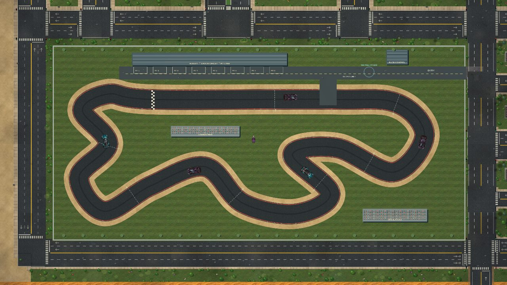
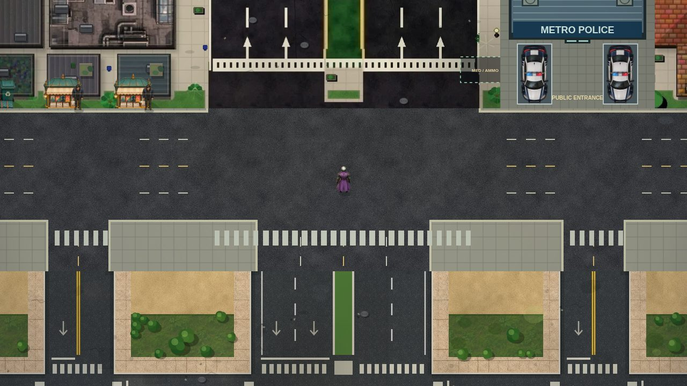

# Coherent roads, motorsport and airborne evidence

This release repairs the south ring-road gateways and the two eastward city exits. Painted paving, collision and road connections now agree at those locations; fountains and forecourt clutter no longer obstruct the connecting lanes. The north–south ring road remains continuous across the east gateways. Full-size hull sweeps cover each repaired approach.

## Bugatti / Crown Circuit

The southwest complex replaces an internal residential grid. Its surrounding boulevards remain connected; ordinary traffic cannot route across the racing surface. The closed technical course has a 7,262-world-unit centreline, alternating kerbs, runoff, perimeter barriers, pits, access lane, control building and grandstands. The existing Nyx Sixteen is the loaner; this is a fan-made location, not a new licensed vehicle model.

- Five dedicated opponents use the same steering and collision physics as other cars. They anticipate bends, brake for vehicles and people, and sleep outside the local area.
- At the pit desk, press **E / TRIAL** for a loaner and three-second countdown. Pass eight sectors in order. Leaving the track invalidates the lap; reversing or jumping between sectors cannot generate a record.
- Personal bests and completed clean laps save with the current game. Busted/wasted recovery cancels the active run. Starting another contract cancels a free time trial.
- **The Eighth Sector**, Fire’s new crew contract, asks for a clean lap under 100 seconds and a stopped return to the pit desk. Its telemetry supports the existing missing-minutes story. The 2,200-chip reward is paid once per completed contract.

## Paper Wings

Take Neural’s new crew contract, collect the evidence drives on foot at the airport, then use a plane to drop them at Red Mesa, Pinewatch and Sierra. **K / J / DROP** releases a package. The blue reticle predicts its impact from current velocity and altitude; a falling parcel has to land inside the current receiver zone. Being near a waypoint alone does not complete a delivery.

Release at 45–220 altitude in stable flight. Misses allow another approach. After all three receivers confirm delivery, land and stop on the eastern runway to collect 2,800 chips. The contract saves completed deliveries; a package still in flight is retried after a reload/recovery. Helicopters, stopped aircraft, low releases and an off-runway return cannot complete the corresponding stages.

## Street AI and presentation

Traffic preflights complete turns against static collision. Compatible swept paths let separate through lanes and non-conflicting turns share a junction. Candidate paths and pair compatibility are reused while a driver waits. Exit clearance and per-step physical collision remain authoritative; drivers do not teleport through obstructions.

Pedestrian crossing checks now use the actual distance to the opposite refuge and relative motion across the whole crossing, including the far lane. Circle/body probes avoid temporary local-point allocations and reject distant vehicles before trigonometry.

Chaos’s roll has a tuck, rotation and recovery over 0.48 seconds, with a shaped speed curve and approximately the same unobstructed travel as before. Blocked movement ends the roll early; animation distance follows actual movement. Reduced Motion suppresses the full rotation.

The map includes casino, circuit and airport markers with direct route buttons. Crew pagination states its page number. Flight controls hide irrelevant weapon buttons and expose DROP only during the cargo objective. All existing story dialogue and choices were checked at small landscape, portrait and desktop sizes. The 52 sprite/premium sheets were visually audited; this release does not replace the original NFT portraits or redraw every asset. The Gold Mage reference, About media and trailer are untouched.

## Rendering and performance

Ground streaming prioritizes the camera centre. A missing expanded-world tile shows its actual surface categories instead of the ocean backdrop. Circuit art is shared by collision-aligned static tiles; Performance mode caches a 1536 × 728 image (about 4.3 MiB of pixels), while desktop uses full resolution. Old images are retired on a texture/quality change. Interior mobile circuit tiles copy directly from that image, avoiding an additional full-resolution ground canvas. Warm minimap icons also reuse rendered images.

The comparison used the exact published commit `d4161c3`, an 844 × 390 touch viewport, Performance quality, adaptive resolution disabled and 4× Chromium CPU throttling. Each sample is four seconds of real touch input. Live actor counts and camera paths vary. These are desktop emulation results, not measurements on a Redmi Note.

| Scene | Published FPS | Release FPS | Release callback median / p95 |
| --- | ---: | ---: | ---: |
| Boulevard | 42.0 | 45.9 | 8.2 / 13.7 ms |
| Regional station | 49.9 | 47.1 | 4.7 / 8.4 ms |
| Forest | 57.5 | 56.1 | 3.6 / 8.6 ms |
| Airfield | 49.6 | 45.0 | 5.7 / 14.3 ms |
| New circuit, five opponents | — | 34.9 | 9.2 / 40.5 ms |

An intermediate uncached AI build regressed to 30.2 FPS on the boulevard and was rejected. Circuit tile streaming initially reached an 83.2 ms callback p95; the direct cached path reduced that sample to 40.5 ms. Results remain mixed outside the dense city, and the circuit can still stutter while streaming. There is no blanket 60 FPS claim. [Raw samples, including intermediate builds](performance/coherence-and-circuit.json).

## Validation and remaining weaknesses

261 Node tests and all 19 core browser checks passed. The new touch mission checks and mobile startup/narrative checks also passed.

The Node suite covers road hull clearance, ordinary-traffic exclusion from the circuit, a complete physics-driven lap with all five opponents, record persistence, shortcut/reverse rejection, busted recovery, both new contract rewards, physical package impacts, runway validation, blocked rolls, far-lane pedestrian prediction and the circuit image budget. Existing campaign, collision, boat, aircraft, train, casino, save and sound checks remain included.

Browser checks use actual pointer, keyboard and touch events: campaign branches, fullscreen, map routes, pit entry, loaner/countdown, crew selection, three package releases, arrival settlement and responsive menus. Cold/warm mobile startup and context restoration retain visible world pixels; all story speech/choices fit the tested layouts. Flight and metro browser journeys also pass.

Traffic still waits behind real obstructions. In the seeded full-city soak, 41.2% of final samples were moving, the longest turn stop was 11 seconds, and the longest overall stop was 94 seconds; 9.1% of final samples had stopped for over 45 seconds. The isolated five-minute network had 62.3% moving, a 37-second maximum stop and no sustained turn stop. These are bounded regression scenarios, not proof that every possible player-created pileup resolves.

The next priorities remain connected pedestrian itineraries, visible recovery/towing for blocked lanes, more distinct authored neighbourhoods and profiling on an actual Redmi Note. Adding more population before that would risk the frame-time headroom this pass recovered.
