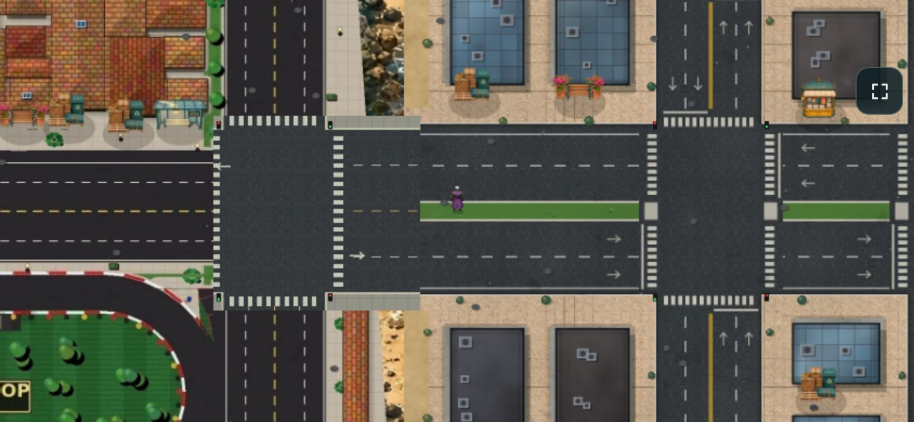

# Traffic, streaming and map polish

Drivers could retain reservations at junctions they had already left. Once another reservation overwrote the vehicle's release state, those old reservations could survive indefinitely. Cleanup now checks ownership against the actual zone; a vehicle finishes releasing its previous junction before reserving another. Cached turn progress resets on entry. Buses also check their onward lane clearance before dispatch, including rejecting multi-arm approaches where the only fitting departure would be a U-turn against opposing traffic.

The deterministic four-minute full-game soak improved from 41.2% to 53.4% moving traffic in the final minute. Samples stopped for over 45 seconds fell from 9.1% to 1.6%. The longest stop fell from 94 to 73 seconds; the longest stopped turn fell from 11 seconds to zero. These include actual pedestrians, parked cars, emergency vehicles and collision physics. Queues behind physical obstructions remain possible; this does not claim universal gridlock recovery. The reservation-only intermediate reached 59.8% moving but left a bus stranded for 100 seconds, so it was not the final routing behavior.

## World and atlas

The east gateways now show crosswalks and directional markings. Lane separators derive from the road's lane count and median width, and asphalt uses the same material as adjoining procedural roads. Gateway images rebuild when those materials finish loading. A reusable, wrapped weathering texture replaces random gradients clipped at ground tile boundaries.

Atlas labels avoid one another, the map edges, station markers and casino/circuit/airport badges. Names that do not fit are suppressed while their location markers remain visible; the three direct destination buttons remain available. Geography continues to use the actual collision map.

## Mobile rendering

Detailed outer-world tiles now compose in resumable stages within a 2.5 ms work allowance per rendered frame. Ground draws directly at the final 256×256 mobile tile resolution; there is no second full-resolution ground cache. Roads and water remain legible through a coarse collision-map image while the detailed tile is pending. Pending jobs and their canvases are retired on eviction or context restoration. The allowance is cooperative, not a hard frame cap: individual raster operations and image decoding can still exceed it.

The controlled cold-render comparison uses 120 manually paced frames per location at 844×390, DPR 2, Performance quality and 4× CPU throttling, with simulation stopped to isolate rendering. Complete details take more frames to arrive. This trades immediate detail for more responsive input and animation while streaming.

| Location | Render p95 before → after | Maximum before → after | Frames to full detail before → after |
| --- | --- | --- | --- |
| Circuit | 42.6 → 17.1 ms | 278.1 → 141.6 ms | 11 → 55 |
| Airfield | 54.1 → 15.0 ms | 153.4 → 63.8 ms | 10 → 42 |
| Forest | 40.4 → 10.7 ms | 374.8 → 222.6 ms | 8 → 26 |
| East gateway | 47.5 → 22.8 ms | 248.4 → 188.1 ms | 9 → 36 |

Full-game touch samples remain mixed because actor populations and travel differ: airfield 29.2 → 55.9 FPS, boulevard 44.1 → 47.9, regional 48.2 → 40.9, forest 49.7 → 56.8. These short samples are diagnostic, not a blanket FPS improvement or a Redmi Note measurement. The cold-render comparison is the clearer evidence for the streaming change. Single first-use spikes and dense queues still warrant further work.

[Raw measurements](performance/traffic-streaming-polish.json). Reproduce with `tools/streaming-profile.cjs`, `tools/world-profile.cjs` and `tools/traffic-audit.mjs`.

Validation: 264 Node regressions, 19 core Chromium checks, touch circuit/package-drop missions, mobile startup and context restoration, responsive story text and metro journeys. Original NFT portraits, the trailer and About media are unchanged.
